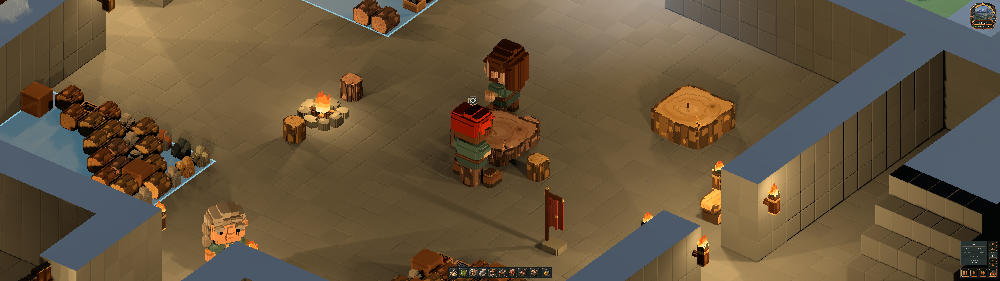

# 250 — Famished dining range

The player requested that dwarves retain the normal 16-block dining range after
collecting food, even while famished, and asked for verification with Birna in
the existing save.

`DwarfDining` now always uses `food.dining_distance`. This component starts only
after the dwarf receives a real food portion. The unused
`desperate_dining_distance` setting is removed. The two-second incremental search,
per-frame probe budget, 16-block routed-distance limit, privacy, free-seat checks,
exclusive claims and bounded travel retain their existing behavior. Food
acquisition, emergency foraging, need thresholds and nutrition are unchanged.

## Copied-save verification

The original quicksave was copied to isolated test storage and loaded through
normal startup, with no changes to colony positions, furniture or dwarf needs.

Before the fix, Birna collected a blueberry at `(279,43,535)` with approximately
4.6% food. Her six-block dining search rejected every nearby free seat; the
closest walkable approach was 7.21 blocks away. She ate at the stockpile and
recorded `last_dining = neither`, with the −8 dining thought and 47% happiness.

With the fix, Birna's normal simulation included a failed food-collection walk
and a retry, then selected a wild strawberry from storage. At approximately 3%
food she chose the south stool **97** beside dining table **94**, using a
7.24-block route. She carried the portion to access cell `(275,43,529)` and ate
seated. The stool belonged to dwarf 4 (Birna); measured torso bottom and seat top
both equalled **Y44.875**. Completion recorded `last_dining = proper`, restored
food to approximately 62%, and left no dining penalty. Happiness was 55%, from
her existing bedroom and chilly-sleep memories. The differing fruit reflects
normal selection after the retry; the test did not change stored inventory.

## Regression checks

`DwarfDiningTest` now exercises hungry and famished dwarves collecting actual
stored berries and carrying them more than six blocks to a free seat and table.
Both complete proper meals, conserve the uneaten portion while travelling and
consume exactly one berry. A separate famished case keeps genuinely walkable
furniture beyond sixteen blocks and verifies bounded fallback and conservation.

The expanded dining test, `DwarfFoodTest` and `DwarfIdleBehaviorTest` all pass.
They also cover arrangement preference, seat contention, interruption, foraging,
nutrition, saved meal state, post-meal seated rest and worker availability.
The native copied-save run additionally asserts proper completion, the seat's
owner and physical seated contact, and captures the actual meal.

Backups, unchanged-save hashes, before/fixed reports, native screenshot and test
results are in `tmp/dining_fix_20261019/`. Both observations used the same input
save hash; all four original player save files remain unchanged. No save schema,
export or commit was created. Restart Play and load the existing save.
