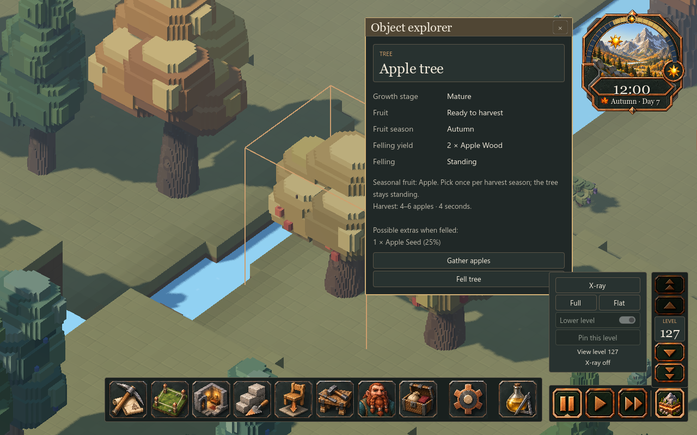
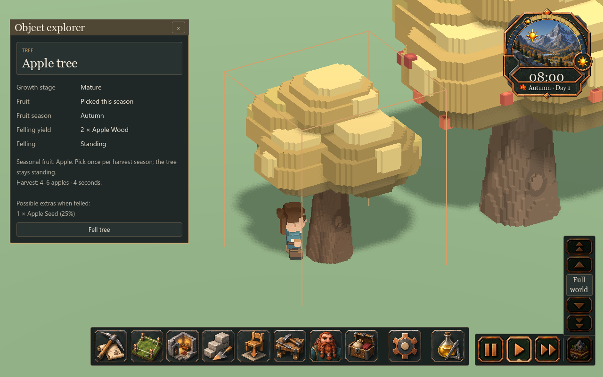

# 252 — Gather apples from standing trees

Implemented 2026-10-19 after the player found an in-season apple tree whose
inspector offered only **Fell tree**. Apple fruit and seasonal models existed,
but its stage definitions had no picking duration, so the shared tree harvest
system excluded apples. That system also assumed a fixed berry yield and used
juniper-specific labels. Felling yielded wood and possible seeds, never apples.

## Player behavior

- Select a ripe apple tree and choose **Gather apples**, or use **Orders →
  Harvest plants** to click or drag over apples, junipers and ripe shrubs.
- Mature trees yield **4–6 apples** after **four seconds** of hand picking;
  ancient trees yield **7–10** after **six seconds**, at normal simulation speed.
  Saplings are too young. Each tree produces one crop per autumn.
- Picking leaves the tree, trunk collision and navigation occupancy intact.
  Visible apples disappear; Fruit reads **Picked this season**. Fruit returns
  next autumn. Missed crops do not accumulate or queue automatic orders.
- Workers leave the real crop on their accessible side of the tree for normal
  hauling or consumption. Hungry dwarves can eat these apples. Emergency
  self-foraging remains the existing nearby berry-shrub behavior.
- Cancel harvest, Cancel orders and Undo release the job. Interrupted or
  cancelled work remains available for the same crop. Felling is a separate
  explicit action and grants no extra apples.

This native capture loads an unchanged copy of the player's quicksave and
selects the mature apple at **(342, 27, 365)**. Autumn and noon are set only in
the unsaved diagnostic session to make the action and fruit visible. The saved
world contains 160 standing apple trees. No original player save is written.

## Implementation and persistence

`SurfaceFloraSpawner` retains sole ownership of tree definitions, crop state,
work and completion. Apple's JSON adds picking durations and fruit/action
labels while retaining its existing yield ranges. The shared harvest path
accepts fixed `yield_count` or inclusive `yield_min`/`yield_max`. A tree/year
hash chooses the apple crop deterministically, so interruptions and reloads
cannot reroll the yield. Juniper still yields exactly two/four berries.

The existing `HARVEST_TREE` lease, bounded perimeter path search, single worker
claim and hand-gathering pose are reused. Completion records the harvested cycle
before spawning items. Inspector, worker activity and roster labels name apples.
The seasonal resolver uses `autumn_fruiting` only for unpicked crops; picked
apples use the existing ordinary autumn model with the same shape variant.
There are no asset edits or new global classes.

Existing forestry fields already save the action, independent picking/felling
progress, work cycle and harvested cycle. No schema change or migration is
needed. Existing unpicked adult apples are eligible in autumn; felled trees
remain felled. Leaving autumn releases pending/active picking, and a new year's
crop starts fresh work. Restoring or streaming a picked tree cannot renew fruit.

## Verification

- `AppleHarvestTest` executes real worker picking, interruption/resume, pause,
  JSON restore, mature/ancient yield ranges, stale/repeated completion exclusion,
  standing body/occupancy preservation, picked visuals, season cancellation,
  annual renewal, click/rectangle orders and Undo, and separate felling.
- A hungry worker eats one real freshly harvested apple, gains its nutrition,
  and consumes exactly one unit. Worker inspector and roster say **Harvesting
  apples**. Native ready/picking/picked captures pass and were visually reviewed.
- `JuniperHarvestTest`, `TreeFellingTest`, `TreePilotTest` and `DwarfFoodTest`
  pass, preserving existing gathering, felling, tree-model and food behavior.
- `ObjectExplorerTest` passes tree selection, terrain/slice/tool guards, season
  continuity and inspector bounds at 960×540, 1280×720 and 2560×1440. Its stale
  barrel fixture now uses the shared synthetic test container, and its flat
  world's generation maps are initialized for terrain baseline queries.
- `SaveManagerRoundTripTest` passes the full save/load and backup pipeline with
  seven forestry records, including picked and partially gathered apples as
  well as junipers and felling. A separate native copy of the actual player save
  restores and exposes **Gather apples**. Actual picking/eating is exercised in
  the controlled worker fixture, not by modifying the player's colony.

The initial apple fixture counted crates instead of contained apples and lacked
the detail owner needed by the combined plant tool; both fixture errors are
corrected. The first inspector run exposed the stale barrel and absent synthetic
generation maps described above. Corrected final runs supersede those failures.

The default job reliability gate now includes apple and juniper harvesting.
Recovery source is in `tmp/apple_harvest_20261019/before.zip`; source-save copies,
native images, test logs and the completion record are beside it. Restart Play
to reload the definitions. No export or commit is produced.
