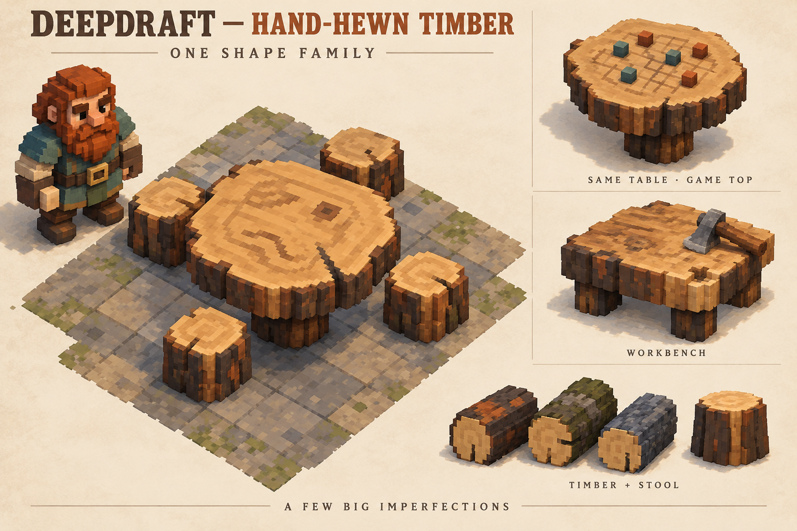

# 64 — Deepdraft's ongoing art direction

**Standing direction: 1:16 chibi / stylized voxel art.** This applies to solid
non-terrain assets: dwarves, animals, trees and smaller plants, furniture, tools
and loose goods, including their growth, seasonal, material and packed variants.
One micro-voxel cell is **1/16 of a world block on each axis**; sixteen cells span
one block edge. A world block is one Godot unit, so a cell is 0.0625 unit. Objects
can occupy multiple blocks while retaining that cell size.

Chibi means substantial, expressive proportions and shapes that read clearly
at colony distance: broad faces and beards, chunky hands and boots, clustered
foliage, thick timber and stone, and a few deliberate imperfections. It does
not mean making every object round. Preserve the established simple world voxels
and approved gameplay dimensions. This is the ongoing design standard, including
families awaiting further refinement; it does not imply that every model has
already reached the target quality.

**Approved reference, 2026-10-18.** The player selected the original hand-hewn
timber concept as the go-forward art direction and accepted the current native
models **for now**. This is provisional acceptance of the implementation, not a
statement that its artistic quality matches the concept.

## Visual authority

`reference/hand_hewn_timber_direction.png` is the canonical reference. It is the
original detailed illustration supplied again by the player, not the later
simplified concept or the Godot preview. Preserve this file and review it before
future work on this family. Its SHA256 is
`a71a88e796c0ae4e05e904657c1b5a80ca8205b8f912a91dc62b559a9b07ca8d`.

The illustration establishes the desired shape, material richness, warmth and
charm. The current native models establish working dimensions and integration.
Do not lower the visual target to match the current implementation, or present
passing geometry tests as evidence that the artistic target has been achieved.

The broader direction is sturdy, expressive, stylized voxel craft: broad forms,
deliberate asymmetry, substantial edges, warm readable materials and a few large
imperfections. Apply these principles to future characters, nature and objects
as those families are revised. The initial milestone implemented the timber
family; subsequent resource, dwarf and tree revisions are recorded below.

## What future revisions should improve

- **Shape and depth:** bark plates should have convincing thickness, varied
  lengths and irregular shoulders. Avoid straight repeated grooves that make
  logs resemble manufactured columns.
- **Cut surfaces:** use off-center, incomplete grain marks, localized knots and
  changes in cut fibre. Avoid regular concentric targets or a uniformly flat,
  evenly patterned top.
- **Imperfections:** a broad drying split, chipped lip or worn working area
  should explain age and use. Vary their shape deliberately; avoid scattered
  random noise.
- **Material richness:** retain dark bark against honey-colored cut wood, with
  restrained warm and cool patches. The reference has richer local color and
  surface depth than the accepted first implementation.
- **Stylized proportions:** the character reference has substantial square
  facial forms, an expressive face and chunky hands, boots and beard masses.
  Enlarging heads alone will not deliver this character.
- **Presentation:** assess the models in the actual game, close and at colony
  distance. The illustration's soft lighting contributes to its appeal, but
  lighting must not conceal weak shapes or unreadable materials.

## Constraints that still apply

Keep the native 1:16 object grid, greedy baked meshes, shared/cached materials
and separate shadow-only proxies. Preserve existing interaction dimensions,
pivots, wood variants and saved identities until a specific change is approved.
The dining table remains 3×3, with four stools inside a 5×5 arrangement; the game
table shares its body. The player approved an eight-cell tabletop over the
unchanged sixteen-cell pedestal in [239](../00_dev_roadmap/239_thicker_log_tabletops.md),
making both table bodies 24 cells tall; game counters sit above that surface.
The workbench remains 16 cells high and uses the accepted
solid stump form. The illustration's separate workbench feet and decorative axe
are future design choices, not implemented features.

The illustrated paving does **not** authorize new terrain textures. Keep the
existing simple world voxels. Likewise, the illustrated dwarf is an art target,
not a character replacement delivered by the original timber milestone.

## Timber refinement

[244 — Timber refinement](../00_dev_roadmap/244_chibi_timber_refinement.md)
revises the installed family with unequal bark plates, staggered clefts, chipped
shoulders, broad fibre patches, incomplete grain and a deeper tapered split.
Dining/game tables retain their shared eight-cell slab, stools retain the 5×5
arrangement, and sideways timber remains the same rotated stool shape. All four
woods and the solid workbench are included. Future passes should improve the
material richness and sculpted transitions further; the original concept still
sets the artistic target. Native captures and measured costs are recorded in 244.

## Buildable furniture extension

The player approved all three furniture groups on 2026-10-18.
[245 — Buildable furniture](../00_dev_roadmap/245_chibi_buildable_furniture.md)
extends the direction to beds/doors, fences/gates/bridges and torches/campfires,
including the existing stone hearth. Use broad clipped timber sections, stronger
braces and bindings, sparse wear and uneven stone courses. Preserve the current
sleep plane, door hinges, fence post envelope, flush bridge deck and fire roots.
The four wood palettes and all five bridge spans remain supported. Actual Godot
previews are in the milestone; the original concept remains the higher target.
This extension does not authorize restoring retired furniture.

## Log bench extension

The player requested a richer chibi log bench occupying 1×2 world voxels on
2026-10-19. [248 — Log bench](../00_dev_roadmap/248_chibi_log_bench.md) replaces the
plain slab with a thick split log, curved underside, uneven bark patches, exposed
end grain, chipped edges and a tapered drying split. Two stout cross-logs support
it. Keep the existing two-cell footprint in either orientation and the flat
one-block-high seat, all four woods and the single broad dwarf seating place.
The seated pose and clearance now fit the current chibi body and boots. Native
previews document the result; the original concept remains the artistic target.

## Dwarf extension

The player authorized the dwarf pass on 2026-10-18.
[241 — Dwarf refinement](../00_dev_roadmap/241_chibi_dwarf_refinement.md) replaces
the repeated hair-cap terraces with broad offset locks and fringes, gives the
seven beard styles larger masses, sculpts cheeks/noses/brows, and adds substantial
sleeves, linen collars/cuffs and a brass belt buckle. All fourteen hairstyles,
four age heads and eight eyebrow styles retain their existing IDs and pools.

Keep the current head/body proportions, detached limbs, native cell size and
eye/palm/sole contacts. The existing footprint, stool support and table clearances
are working constraints. Facial character should come from deliberate shape
choices and expressive brows, not extra random surface noise. The original
concept remains the visual target; the native pass is not claimed to equal its
soft rendering or richness. Review the actual screenshots in 241 for the result.

## Tree extension

The player authorized the tree pass on 2026-10-18.
[242 — Tree refinement](../00_dev_roadmap/242_chibi_tree_refinement.md) applies
the same substantial forms to all four species, growth stages and defined
seasonal/picked variants. Pine boughs become fuller and uneven; oak gets a broad
clustered crown; apple remains compact with readable blossoms and fruit; juniper
becomes dense and upright. Broad bark plates and localized knots add character.

Keep the native cell grid and existing gameplay dimensions. Favor overlapping,
offset leaf masses with broad steps, rather than thin repeated discs or noisy
micro-detail. Snow belongs on the exposed foliage tops; bare winter limbs should
form a connected tree. The new native captures are an implementation iteration,
not a new illustrated reference or a claim that the original concept's material
richness has been reached. World terrain retains its owner.

## Bush and small-plant extension

The player authorized this next pass after reviewing the completed tree stages.
[243 — Plant refinement](../00_dev_roadmap/243_chibi_plant_refinement.md) installs
all 76 blueberry, elderberry, strawberry, wildflower and reed forms. Broad offset
foliage, larger exposed fruit, thicker flower heads and stepped reed blades bring
the small plants into the same substantial shape family.

Keep distinct species silhouettes and actual gameplay scale. Young shrubs need
complete small crowns, mature shrubs need readable crops, and packed roots must
support the exact same plant. Seasonal foliage, bloom, picked and dormant forms
remain distinct. Preserve timing, yields, placement and saved identities. The
native captures document the current implementation; they do not replace the
original concept as the higher target. Crops and world textures are unchanged.

## Approved resource extension

On 2026-10-18 the player approved the lower row of the
[chunky resource concept](reference/proposals/chunky_resources_v1.png) for all
stone, ore and dirt goods. [238](../00_dev_roadmap/238_chunky_mined_resources.md)
installed fourteen variants. Ten remain after the four unused stone types were
removed in [251](../00_dev_roadmap/251_retired_stone_types.md). This extends the same broad-form direction to compact
fragments: asymmetric broken stone, large exposed mineral patches and softer
joined soil clods. The original round source is retained for recovery, but its
exact silhouette is no longer the active art requirement.

The resource comparison is an illustration; its upper row redraws the prior
shape and is not an engine capture. Native results are saved separately in 238.
Keep the existing 0.75-unit size and 1:16 cells. Preserve material readability,
ground contact, carrying/storage fit and separate shadow proxies as the art
improves. Terrain blocks, scenery boulders and gems are separate families.

See [63 — Technical art standard](63_shared_art_standard.md) for renderer and
validation contracts, [236 — Native study](../00_dev_roadmap/236_native_hand_hewn_timber_study.md)
for the interim appearance, and [237 — Production installation](../00_dev_roadmap/237_hand_hewn_timber_activation.md)
for integration and tests. Future implementation attempts should compare native
screenshots with the original concept and describe the remaining visual gap
candidly.
